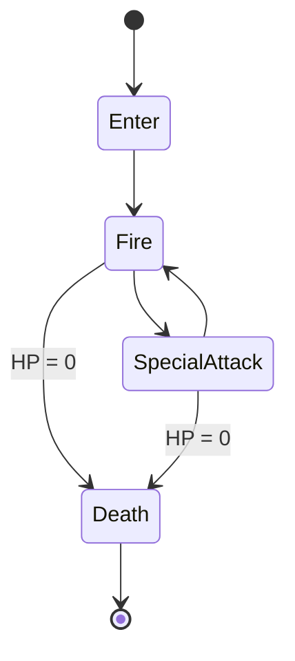

[README.md](https://github.com/user-attachments/files/34290155/README.md)
<div align="center">

# 🚀 Space Shooter Mobile

**A fast-paced 2D arcade space shooter for mobile, with level progression, power-ups, and epic boss fights.**


<!-- Replace with a real GIF/screenshot of your gameplay -->


</div>

---

## 📖 About

**Space Shooter Mobile** is a 2D Space Invaders-inspired shooter built with **Unity** and **C#**, designed for touch controls and mobile performance.

Fight through hand-crafted levels, collect power-ups, and take down a unique boss at the end of every stage. The UI is fully localized in **Persian (Farsi)** with RTL text support.

## ✨ Features

### 🎮 Gameplay
- **Level-based progression**: choose your level from a scrollable selection menu; completed levels unlock the next ones.
- **Boss fights**: every level ends with a boss that has its own stats, attack patterns, and death sequence.
- **Randomized enemy spawning**: enemy waves are spawned dynamically and configured per level.
- **Power-ups** for the player:
  - ❤️ **Heal**: restore health
  - 🛡️ **Shield**: temporary protection with an on-screen shield UI
  - 🔫 **Shooting upgrade**: boost your firepower
- **Win / Lose conditions** with dedicated result screens and quick *restart* / *change level* buttons.
- **Score system** with persistent **high score** saving and loading.

### 🖥️ UI / UX
- Start screen with logo and main menu
- Level selection with info panel
- Settings menu and quit-confirmation panel
- Smooth **fade transitions** between scenes and a **loading screen**
- **Persian (RTL) UI text** support
- Sound effects for power-ups and gameplay events

### 💰 Monetization
- Ad network integration with **Tapsell**

## 🧠 Technical Highlights

This project focuses on clean, scalable game architecture, not just "making it work".

| Concept | Where it's used | Why it matters |
|---|---|---|
| **State Machine pattern** | Boss AI (`Enter` → `Fire` → `Special Attack`) driven by a state controller | Keeps boss behavior modular and easy to extend with new states |
| **Object Pooling** | Bullets | Avoids constant `Instantiate`/`Destroy`, reducing GC spikes on mobile devices |
| **ScriptableObjects** | Enemy spawn data per level | Data-driven design: designers can tweak waves without touching code |
| **Singleton pattern** | `GameManager` | Central access to game state (win / lose / restart) |
| **Panel controller** | UI screens | One place to manage which panel is visible |
| **Scene management** | Fade + loading screen | Polished transitions between menus and levels |
| **Persistence** | High score save/load | Progress survives app restarts |

### 👾 Boss State Machine



### ⚡ Performance Notes
- Bullets are pooled and returned to the pool instead of being destroyed.
- Off-screen objects (e.g. missed shield power-ups) are cleaned up automatically.
- Debug logs are removed from gameplay code.

## 🛠️ Built With

- [Unity](https://unity.com/) (2D)
- C#
- Tapsell SDK (ads)
- Persian text support package for RTL rendering

## 🚀 Getting Started

### Prerequisites
- Unity Hub
- Unity **`<your-unity-version>`** (check `ProjectSettings/ProjectVersion.txt`)
- Android Build Support module (for mobile builds)

### Run locally

```bash
# 1. Clone the repository
git clone https://github.com/msalehabadi/Space-Shooter-Mobile.git

# 2. Open the project with Unity Hub
#    Unity Hub → Add → select the cloned folder

# 3. Open the Start scene and press Play
```

### Build for Android
1. `File → Build Settings → Android`
2. Switch Platform
3. Add all scenes to **Scenes In Build**
4. Click **Build** (or **Build And Run** with a connected device)

## 🕹️ How to Play

1. Pick a level from the level selection screen.
2. Move your ship and shoot down incoming enemies.
3. Collect power-ups to heal, shield, or upgrade your weapon.
4. Defeat the boss to win the level and unlock the next one.
5. Beat your own high score!

## 🗺️ Roadmap

- [ ] More levels and unique boss designs
- [ ] Object pooling for enemies and VFX
- [ ] Event-driven architecture to reduce coupling with `GameManager`
- [ ] More power-up types
- [ ] Safe Area and multi-aspect-ratio support
- [ ] Leaderboards
- [ ] iOS build

## 📸 Screenshots

<!-- Replace these with real screenshots -->
| Main Menu | Level Selection | Boss Fight |
|:---:|:---:|:---:|
|  |  |  |

## 📥 Download

<!-- Add your link when you have a release -->
- [Latest APK](https://github.com/msalehabadi/Space-Shooter-Mobile/releases)

## 🤝 Contributing

Contributions, issues, and feature requests are welcome!
Feel free to open an [issue](https://github.com/msalehabadi/Space-Shooter-Mobile/issues) or submit a pull request.

## 📄 License

Distributed under the MIT License. See `LICENSE` for more information.
<!-- Change this if you use a different license -->

## 👤 Author

**M. Salehabadi**
GitHub: [@msalehabadi](https://github.com/msalehabadi)

---

<div align="center">

⭐ If you enjoyed this project, consider giving it a star!

</div>
